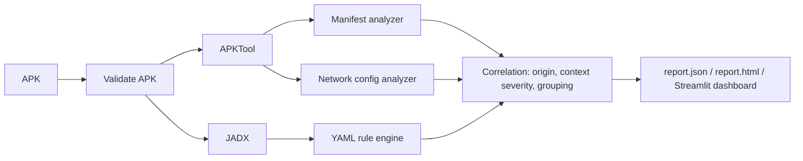

# Android Security Assessment Lab (ASAL)

**A static-analysis assistant that helps analysts find, verify and document Android application vulnerabilities.**

ASAL decompiles an APK, runs its own manifest, network-config and code analyzers, correlates the results, and produces an evidence-based report mapped to **OWASP MASVS v2** and **CWE**. It does not replace the analyst: every automated finding starts as *auto* and only becomes *verified* after manual confirmation, with notes.

> For authorized testing and intentionally vulnerable apps only.

<!-- Add screenshots: docs/screenshots/dashboard.png, docs/screenshots/finding.png, docs/screenshots/report.png -->

## Why another tool?

Existing scanners (e.g. MobSF) are powerful but often produce long, noisy lists: library code mixed with app code, one line per exported component, severities without explanation. ASAL focuses on what an analyst needs to make and defend a decision:

| | What ASAL does |
|---|---|
| **App vs library** | Skips well-known libraries by default and labels every finding `app` or `library`. On AndroGoat: 80 app files analysed, 3,175 library files skipped. |
| **Grouping** | Repeated hits of one rule become one finding with many locations. |
| **Context-aware severity** | An exported component that *reads Intent data* is raised one level, with the reading line added as evidence. Every change is explained in `severity_reason`. |
| **Precise evidence** | Every finding has file, line and a code snippet with the matched line highlighted. A finding without evidence cannot be created. |
| **Manual verification** | Each finding includes *How to verify* steps (ready-to-run `adb` commands with the real package/component names). |
| **Review workflow** | Mark findings *verified* / *false positive* (notes required). Decisions survive re-scans (deterministic IDs). |
| **Coverage** | Shows checks that passed or were not applicable, not only failures. |
| **No opaque score** | Counts by severity and review status instead of a "security score". |
| **Transparent rules** | Detection logic is readable YAML; every rule has positive and negative tests. |
| **Measured** | Benchmarked against a hand-written ground truth (see below), including what it misses. |

## Architecture



Details: [docs/architecture.md](docs/architecture.md) · Severity and status rules: [docs/methodology.md](docs/methodology.md)

## What it checks

- **Manifest**: debuggable, backup, cleartext, exported activities/services/receivers/providers (Android export rules incl. implicit export, permission strength, launcher and deep-link handling), minSdk, dangerous permissions
- **Network Security Config**: cleartext (global/domain), user-installed CAs, pinning coverage
- **Code (17 rules)**: hardcoded secrets/keys (incl. AWS, Google, OpenAI formats), weak ciphers (ECB/DES/RC4), hardcoded keys/IVs, weak hashes, insecure random, WebView JavaScript / JS bridge / file access, world-readable files, external storage, SQL injection, disabled TLS validation, sensitive logs, sensitive SharedPreferences, command execution, clipboard, temp files

## Quick start

Requirements: Python 3.10+, Java 11+, [JADX](https://github.com/skylot/jadx) and [APKTool](https://apktool.org) on `PATH` (or set `ASAL_JADX` / `ASAL_APKTOOL`).

```bash
python -m venv .venv
.venv\Scripts\activate            # Windows  (Linux/macOS: source .venv/bin/activate)
pip install -r requirements.txt
python -m pytest -q
```

### CLI

```bash
python -m asal scan samples/AndroGoat.apk -o out/androgoat
# options: --skip-jadx (manifest only), --include-libs (also scan known libraries), -v
```

Outputs `out/androgoat/report.json`, `report.html` and `asal.log`.

### Dashboard

```bash
streamlit run ui/app.py           # bound to localhost by .streamlit/config.toml
```

Upload an APK → review findings → mark verified / false positive → export the report.

## Rule format

```yaml
- id: CODE-WEAK-CIPHER
  title: Weak or insecure cipher mode
  severity: high
  confidence: high
  masvs: MASVS-CRYPTO
  cwe: CWE-327
  patterns:
    - 'Cipher\.getInstance\(\s*"(AES|DES|DESede|RC4|ARCFOUR|Blowfish)"\s*[,)]'
    - 'Cipher\.getInstance\(\s*"(?!RSA/)[^"]*/ECB/[^"]*"'   # RSA/ECB is not a weakness
  exclude_patterns: []
  impact: ...
  remediation: ...
  how_to_verify: ...
```

Add a rule → add a positive and a negative sample in `tests/test_code_rules.py` (the test suite fails if a rule has no test cases).

## Benchmark

Ground truth for AndroGoat was written from the app's source and lab descriptions, independently of ASAL's output: [ground_truth/androgoat.yaml](ground_truth/androgoat.yaml).

```bash
python benchmark/benchmark.py out/androgoat/report.json ground_truth/androgoat.yaml
```

## Benchmark: AndroGoat

- Static ground-truth items: **27**
- Detected: **22** · Missed: **5** · Detection rate: **81%**
- Dynamic-only items (out of scope for static analysis): 5
- ASAL findings in app code: 21 · matched to ground truth: 19 · unmatched (needs triage): 2

| ID | Vulnerability | Expected rule | Result |
|---|---|---|---|
| AG-01 | Debuggable release build | MANIFEST-DEBUGGABLE | ✅ detected |
| AG-02 | Backup enabled (allowBackup) | MANIFEST-ALLOW-BACKUP | ✅ detected |
| AG-03 | Exported activity - access control bypass | MANIFEST-EXPORTED-ACTIVITY | ✅ detected |
| AG-04 | Exported service DownloadInvoiceService | MANIFEST-EXPORTED-SERVICE | ✅ detected |
| AG-05 | Exported broadcast receiver ShowDataReceiver | MANIFEST-EXPORTED-RECEIVER | ✅ detected |
| AG-06 | Exported content provider (user PINs) | MANIFEST-EXPORTED-PROVIDER | ✅ detected |
| AG-07 | Cleartext traffic allowed (NSC base-config) | NSC-CLEARTEXT-GLOBAL | ✅ detected |
| AG-08 | User-installed CAs trusted (NSC) | NSC-USER-CA | ✅ detected |
| AG-09 | Hardcoded AWS access/secret keys | CODE-HARDCODED-SECRET | ✅ detected |
| AG-10 | Hardcoded OpenAI API key | CODE-HARDCODED-SECRET | ✅ detected |
| AG-11 | Hardcoded promo code | CODE-HARDCODED-SECRET | ❌ missed |
| AG-12 | Credentials hardcoded in receiver Toast text | CODE-HARDCODED-SECRET | ❌ missed |
| AG-13 | SQL injection in login query | CODE-SQL-INJECTION | ✅ detected |
| AG-14 | SQL built from user input in INSERT | CODE-SQL-INJECTION | ✅ detected |
| AG-15 | Password stored in plaintext SQLite table | - | ❌ missed (no rule yet) |
| AG-16 | PIN hashed with MD5 | CODE-WEAK-HASH | ✅ detected |
| AG-17 | Credentials written to logcat | CODE-SENSITIVE-LOG | ❌ missed |
| AG-18 | Cloud keys written to logcat | CODE-SENSITIVE-LOG | ✅ detected |
| AG-19 | Credentials in SharedPreferences (plaintext) | CODE-SENSITIVE-PREFS | ✅ detected |
| AG-20 | User data written to SD card | CODE-EXTERNAL-STORAGE | ✅ detected |
| AG-21 | User data in temp file | CODE-TEMP-FILE | ✅ detected |
| AG-22 | XSS in WebView | CODE-WEBVIEW-JS-ENABLED | ✅ detected |
| AG-23 | XSS via QR code in WebView | CODE-WEBVIEW-JS-ENABLED | ✅ detected |
| AG-24 | WebView file access from user URL | CODE-WEBVIEW-FILE-ACCESS | ✅ detected |
| AG-25 | OS command injection | CODE-COMMAND-EXEC | ✅ detected |
| AG-26 | Sensitive data copied to clipboard | CODE-CLIPBOARD | ✅ detected |
| AG-27 | Keyboard cache on credential fields | - | ❌ missed (no rule yet) |
| AG-28 | SharedPreferences score tampering | - | ⚪ dynamic (out of scope) |
| AG-29 | Root detection bypass | - | ⚪ dynamic (out of scope) |
| AG-30 | Emulator detection bypass | - | ⚪ dynamic (out of scope) |
| AG-31 | Binary patching (admin check) | - | ⚪ dynamic (out of scope) |
| AG-32 | Biometric authentication bypass | - | ⚪ dynamic (out of scope) |

### Unmatched findings (triage)

| Finding | Rule | Review status | Notes |
|---|---|---|---|
| App supports outdated Android versions (minSdk 19) | MANIFEST-MIN-SDK | auto |  |
| App requests 3 dangerous permission(s) | MANIFEST-DANGEROUS-PERMISSIONS | auto |  |


**Known misses (by design of pattern-based static analysis):** secrets inside UI strings (e.g. a password in a Toast message), values whose variable names do not indicate sensitivity (e.g. a promo code, a log message variable), plaintext credentials in SQLite tables, and keyboard-cache settings in layout XML. Dynamic-only issues (root/emulator detection bypass, binary patching, biometric bypass, logic flaws) are out of scope.

## Comparison with MobSF

See [docs/comparison.md](docs/comparison.md).

## Manual verification writeups

Selected AndroGoat findings verified on an emulator, with proof-of-concept steps: [writeups/](writeups/).

## Security of the tool itself

- The APK is never installed or executed; ZIP entries with path traversal are rejected (Zip Slip).
- XML parsed with entity resolution and network access disabled (XXE).
- External tools run with argument lists (no shell) and timeouts.
- HTML report uses autoescaping, so code from the analysed app cannot inject script into the report.
- The dashboard listens on localhost only.

## Limitations

- Static analysis only; no runtime, server-side or dynamically loaded code analysis.
- Regex rules can miss issues and produce false positives; findings require manual verification.
- Code JADX fails to decompile is not analysed (reported as a warning, scan marked partial).
- Obfuscated apps reduce the value of name-based rules (e.g. variable names like `password`).

## Roadmap

- Data-flow (source → sink) analysis for Intent extras and user input
- MobSF API import for side-by-side results
- PDF export, scan history
- Dynamic verification helpers (Frida scripts, adb automation)

## Project structure

```
asal/
  core/          models, APK validation, decompilers, scan pipeline
  analyzers/     manifest, network config, YAML code rules
  correlation/   context severity, grouping
  rules/         code_rules.yaml
  reporting/     JSON, reviews, HTML template
ui/app.py        Streamlit dashboard
benchmark/       ground-truth comparison
ground_truth/    known vulnerabilities per test app
docs/            architecture, methodology, comparison
writeups/        manual verification writeups
tests/           pytest suite (unit + pipeline)
```

## Disclaimer

This project is for education and authorized security testing. Only analyse applications you own or have explicit permission to test.
