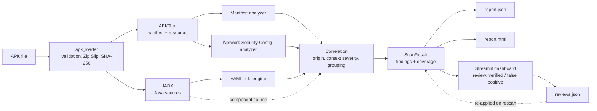

# Architecture

## Modules

| Path | Responsibility |
|---|---|
| `asal/core/models.py` | Single source of truth: `Finding`, `Location`, `CheckResult`, `ScanResult`. Enforces evidence on every finding, a reason for every severity change, and notes for every review decision. |
| `asal/core/apk_loader.py` | Reads the APK as a ZIP; rejects files that are too large, malformed, missing manifest/DEX, or containing path-traversal entries. |
| `asal/core/decompiler.py` | Runs APKTool/JADX with argument lists (no shell) and timeouts; marks partial JADX output. |
| `asal/core/scanner.py` | Pipeline orchestration; failures become `errors` + `partial` instead of crashes. |
| `asal/analyzers/manifest.py` | XML parsing (XXE-safe) of the decoded manifest; Android export rules, permission strength, launcher detection, deep links, adb verification commands. |
| `asal/analyzers/network_config.py` | Cleartext, user CAs (ignoring `debug-overrides`), pinning coverage. |
| `asal/analyzers/code_rules.py` + `asal/rules/*.yaml` | Rule loading/validation and regex matching on JADX output; library skipping and origin classification. |
| `asal/correlation/context_severity.py` | Links exported components to their source and raises severity when they read Intent input. |
| `asal/correlation/dedup.py` | Merges repeated code hits into one finding with many locations. |
| `asal/reporting/` | JSON persistence, review storage, HTML report (Jinja2 with autoescaping). |
| `ui/app.py` | Streamlit UI. No analysis logic; calls the same `run_scan` as the CLI. |
| `benchmark/benchmark.py` | Compares a report with `ground_truth/*.yaml`. |

## Design decisions

- **Deterministic finding IDs** (hash of rule + locations) so review decisions survive re-scans.
- **Coverage (`CheckResult`)** records passed / not applicable / error checks, not only failures.
- **No security score**: counts by severity and review status are easier to defend than an opaque number.
- **Rules as data (YAML)**: readable by reviewers, testable one by one, extensible without code changes.
- **Defensive by default**: XXE-safe XML parser, no `shell=True`, timeouts, upload size limit, HTML autoescaping, UI bound to localhost.
